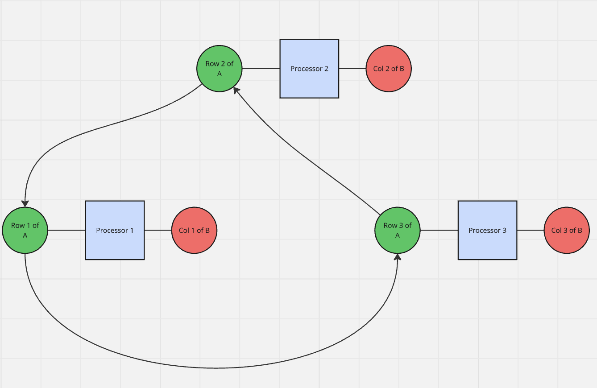

# Parallel Dense Matrix Multiplication #

AMS 530 Project 2, Stony Brook Graduate School

Supervisor: Professor Yuefan Deng, AMS Department, Stony Brook University

## Project Description ##
This project implements parallel dense matrix multiplication using MPI and analyzes scaling performance on the SeaWulf supercomputer cluster.

The algorithm implemented is the ring method, or Cannon's algorithm. The algorithm is then tested on `N = {64, 256, 1024, 4096}` and `P = {4, 8, 16}`, where N is the size of the given matrices and P is the number of processes (cores). For accuracy, the result is compared against a serial baseline.

## Problem Statement ##
Problem 2.3: Design a parallel matrix multiplication using row-wise, column-wise, or block
decomposition. This assignment requires implementing a parallel version using MPI, assuming square
matrices. Tasks are

(1) Algorithm Design: Design a parallel matrix multiplication algorithm using MPI.
- Describe the data distribution.
-  Discuss load balancing, communication overhead, and scalability for P processes.
- Assume matrices are square (size `N × N`) and P divides N.

(2) Implementation: Implement the algorithm in a program.
- Input: Root process generates two random N × N matrices A and B.
- Output: Root process computes and verifies C against a serial version.
- Requirements:
  - Support P = $2^2$, $2^3$, $2^4$.
  - Test for N = $2^6$, $2^8$, $2^{10}$, $2^{12}$.
  - Include a serial baseline for verification.

(3) Performance Evaluation: Create a test harness to:
- Verify correctness.
- Measure execution time.
- Compute speedup.
- Record the timing results and make relevant comments on Amdahl's law

## Algorithm Design ##

### Why Cannon's Algorithm? ###
In class, we generally went over 3 different algorithms: Cannon's Algorithm, Fox's Method, and Strassen's Algorithm. Fox's algorithm was discarded since it requires P to be a perfect square, and one of the required values of P is `P = 8`, thus invalidating the method. As for Strassen's algorithm, the 7 subproblems generated do not divide evenly among the values of P, so at least one rank will sit idle and thus reduce parallel efficiency. Furthermore, the benefits of Strassen's algorithm are modest at $N = 4096$, and do not outweigh the losses from idle ranks. This leaves Cannon's algorithm as the best choice for parallelization.

### Data Distribution ###

Let $w = N/P$ be the strip width. At any time, Rank $r$ holds its designated column strip of B, its current row strip of A, and its column strip of C. So at most, every processor holds $3Nw = 3N^2 / P$ elements of the matrix at any given time.

A diagram of the data distribution for each processor in a basic $N = P = 3$ model can be seen below at t = 0: 



As can be seen, each processor has one slice of A and one of B. After performing the dot product, for t = 1 each processor will pass its matrix A information to the next processor along the chain. This process will then repeat until t = P - 1.

> Also note for ease of communication B is transposed once in the root, so each column strip of B becomes a row strip of BT, which is easier to send

### Load Balancing ###
Since $P$ divides $N$, the work is equally distributed amongst all $P$ ranks. Each rank:
- Does $2N^3/P$ FLOPs
- Sends and receives $P - 1$ equally sized messages
- Holds $3N^2/P$ doubles

Since the split is fixed, no dynamic load balancing is needed. The only serial portions are generating the matrices, the transpose, scatters, gathers, and verifications.
> Note that the transpose and verification, being non-crucial to the core algorithm, are outside the timing window.

### Communication Overhead ###
Communication can be divided into three phases:

| Phase | Style | Per-Rank Data I/O Size | Times executed
| -------- | -------- | -------- | -------- |
| Initial Scatter | Root -> All | $2N^2/P$ doubles | Once
| Ring | Rank $r$ -> $r-1$ (wrap around) | $N^2/P$ doubles | $P - 1$
| Final Gather | All -> Root | $N^2/P$ doubles | Once

Since the ring communication occurs $P - 1$ times and transmits $N^2/P$ doubles, a total of $(P-1)N^2/P$ doubles are transmitted per rank over the whole operation. This means that the total amount of communication barely changes with P while computation per rank shrinks by a factor of $1/P$, so communication becomes a larger share of total runtime as P grows.

In order to avoid deadlock, the `MPI_Send` and `MPI_Recv` commands are replaced with `MPI_Sendrecv_replace`, which sends and receives in one operation. If we ran

```
MPI_Send()
MPI_Recv()
```

then every rank would stall on send for large messages, and no one would ever get to the receive step and so the program would stall out.

### Scalability ###
- Speedup increases as $N/P$ increases
- Per-rank memory inversely proportional to $P$
- $P \le N$
- Root rank is bound by gather/scatter, growing with $N^2$

### Pseudocode ###

```
MPI_Init();
rank, P = MPI_Rank, MPI_Size
read N, reps, warmup time
nb = N / P

IF rank == 0:
    fill A, B with random doubles [-1, 1)
    BT = transpose(B) //For ease of distribution cols -> rows

allocate A_cur, BT_loc, CT_loc //nb x N each

FUNCTION multiply():
    MPI_Barrier()
    MPI_Scatter(A -> A_cur)
    MPI_Scatter(BT -> BT_loc)
    FOR s = 0, P-1:
        src = (rank + s) mod P
        FOR j < nb, i < nb:
            CT_loc[j][src*nb + i] = dot(A_cur[i, :], BT_loc[j, :], N)
        IF s < P-1:
            MPI_Sendrecv_replace(A_cur, send to rank-1, receive from rank+1)
    MPI_Gather(CT_loc -> CT on root)
    RETURN phase timers //scatter, compute, ring comm, gather, total

repeat multiply() for a few seconds, at least 3 //warmup, untimed

FOR rep = 1, reps:
    multiply()
    MPI_Reduce(MAX) for each phase time

IF rank == 0:
    C = transpose(CT)
    C_ref = serial_multiply(A,B)
    max_err = max |C - C_ref|
    print times, speedup, max_err, Pass/Fail

```

## Repo Structure ##
```
Matrix-Mult-Parallel/
├── src/
│   ├── kernel.c           # dot product, serial basline, transpose, and other functions
│   ├── kernel.h           
│   ├── main.c             # Args, data gen, scatter/gather, timing, verification, and output
│   ├── mm_ring.c          # The ring algorithm
│   └── mm_ring.h
│       
├── Make/                  
│   └── Makerfile
├── Images/                # Images for README
├── Bash/
│   └── *.sh               # Various bash files for testing
│                               
├── README.md
├── .gitignore
└── requirements.txt
```